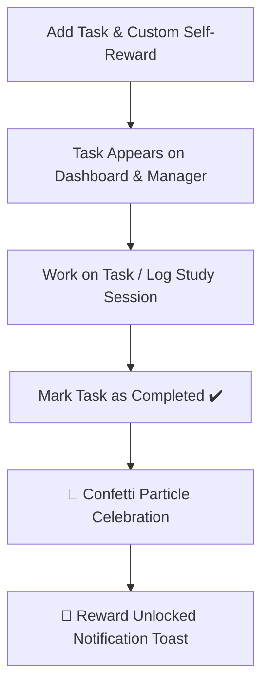

# 📚 Study Pulse — Interactive Daily Study & Project Tracker

<p align="center">
  
  
  
  
</p>

---

## ⚡ Quick Navigation

- [💡 Overview](#-overview)
- [✨ Key Features](#-key-features)
- [🖥️ Interactive UI Dashboard Overview](#️-interactive-ui-dashboard-overview)
- [🎁 Tasks & Reward System Workflow](#-tasks--reward-system-workflow)
- [🚀 Quick Start Guide](#-quick-start-guide)
- [💾 Data Export & Import (JSON)](#-data-export--import-json)
- [🛠️ Tech Stack & Dependencies](#️-tech-stack--dependencies)
- [📄 License](#-license)

---

## 💡 Overview

**Study Pulse** is a feature-rich, single-file web application engineered for students, self-taught developers, and lifelong learners to seamlessly track study sessions, monitor project milestones, manage focus time with Pomodoro timers, and unlock self-customized rewards upon task completion.

> 🔒 **100% Private & Serverless**: All data is stored inside your browser's `localStorage`. No logins, zero setup fees, and full ownership of your data with built-in **JSON Export/Import** support.

---

## ✨ Key Features

| Feature | Description |
| :--- | :--- |
| **📖 Dual Logging Modes** | Log both **Subject Study** (Subject, Topic, Focus Rating) and **Project Work** (Project Title, Start & End Date ranges). |
| **🎁 Custom Tasks & Self-Rewards** | Define task challenges paired with personal rewards (e.g., *“Complete 3 Calculus Modules”* ➔ *“1 Hour Gaming Break”*). |
| **🎉 Gamified Celebrations** | Interactive confetti particle animations trigger when completing tasks or reaching targets. |
| **⏱️ Focus Timer & Stopwatch** | Integrated 25-minute Pomodoro focus timer & flexible stopwatch with visual audio cues. |
| **📊 Analytics & Visual Trends** | Real-time 7-day study trend bar graphs and subject/project time distribution doughnut charts. |
| **🎯 Goal Target Indicators** | Real-time visual progress bars for customizable Daily & Weekly goal hours. |
| **🌗 Light / Dark Mode** | Dynamic theme toggle tailored for late-night study sessions. |

---

## 🖥️ Interactive UI Dashboard Overview

```
+-----------------------------------------------------------------------------------+
|  🧠 Study Pulse    [+ Log Study/Project] [🎁 Tasks & Rewards] [⏱️ Timer] [🌗 Theme] |
+-----------------------------------------------------------------------------------+
|  [⏱️ Total Logged]   [🔥 Active Streak]   [📈 Daily Avg]   [⭐ Focus Rating]       |
|       42h 15m            5 Days             3.5h             4.6 / 5.0            |
+-----------------------------------------------------------------------------------+
|  🎯 Target Progress:                                                               |
|  • Today's Target:  [████████████████████.........] 3.5h / 4.0h (88%)               |
|  • Weekly Target: [████████████..................] 18h / 25h (72%)                |
+-----------------------------------------------------------------------------------+
|  📊 7-Day Trend Chart                     |  🍩 Subject / Project Distribution    |
|  [Bar Graph Visualization]                |  [Doughnut Chart Breakdown]           |
+-----------------------------------------------------------------------------------+
|  🎁 Active Tasks & Self-Rewards Panel                                              |
|  [ + Add Task & Reward Inline Form ]                                               |
|  [✓] Complete Physics Chapter 4   ➔  Reward: 30 Min Anime Break  (Completed)    |
|  [ ] Build React Portfolio Page   ➔  Reward: Treat Myself to Coffee  (Pending)   |
+-----------------------------------------------------------------------------------+
|  📜 History Logs (Search & Filter by Category)                                    |
|  Date Range   | Type & Title     | Duration | Rating | Notes & Takeaways          |
+-----------------------------------------------------------------------------------+
```

---

## 🎁 Tasks & Reward System Workflow



---

## 🚀 Quick Start Guide

### Option 1: Direct File Run (No Installation Required)
1. Download or clone `index.html` locally to your computer.
2. Double click `index.html` to launch it in any modern browser (**Chrome**, **Edge**, **Firefox**, **Safari**).

### Option 2: Run via Local Development Server (Optional)
```bash
# Clone the repository
git clone https://github.com/your-username/study-pulse.git

# Navigate into directory
cd study-pulse

# Launch using Python simple HTTP server
python -m http.server 8000
```
Then open `http://localhost:8000` in your web browser.

---

## 💾 Data Export & Import (JSON)

Never lose your progress across different browsers or devices:

* **Export Data**: Click the **Download (📥)** button in the header bar to save your complete log history, pending/completed tasks, and settings to a `.json` backup file.
* **Import Data**: Click the **Upload (📤)** button in the header bar and select your backup file to instantly restore your data.

### Sample Data Format (`StudyPulse_Backup.json`)
```json
{
  "logs": [
    {
      "id": "log_1710000000000",
      "type": "subject",
      "date": "2026-11-07",
      "subject": "Mathematics",
      "topic": "Calculus Integration",
      "durationMinutes": 120,
      "focus": 5,
      "notes": "Mastered substitution rules and completed 10 practice problems."
    }
  ],
  "tasks": [
    {
      "id": "task_1710000000001",
      "title": "Complete Practice Paper 2",
      "reward": "Watch 1 episode of favorite show",
      "completed": false
    }
  ],
  "targets": {
    "daily": 4,
    "weekly": 25
  },
  "theme": "dark"
}
```

---

## 🛠️ Tech Stack & Dependencies

- **HTML5 & Vanilla JavaScript (ES6+)** — Zero heavy build tools or framework overhead.
- **[Tailwind CSS (CDN)](https://tailwindcss.com/)** — Responsive UI styling with dark mode support.
- **[Chart.js](https://www.chartjs.org/)** — Canvas-rendered interactive analytics & metrics charts.
- **[Canvas Confetti](https://www.npmjs.com/package/canvas-confetti)** — Celebration particle animations.
- **[Lucide Icons](https://lucide.dev/)** — Lightweight iconography.

---

## 📄 License

Distributed under the **MIT License**. Free for personal and educational use. Feel free to fork and customize!